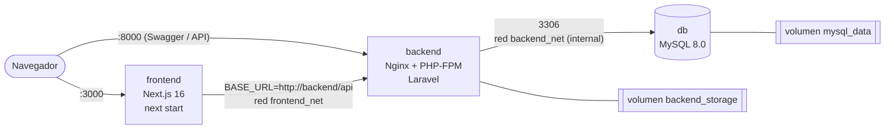

# Ingeniería de Imágenes Eficientes — Next.js 16 + Laravel + MySQL con Docker multi-stage
### By Hugo Ernesto Jovel

Actividad evaluada · Kodigo Full Stack Jr 36 · *Refactorización Multi-stage y Optimización de Capas en Docker*

## 1. Descripción general

Este repositorio prepara para **producción** un ecosistema de tres servicios, construidos con las aplicaciones desarrolladas durante el bootcamp:

| Servicio | Tecnología | Imagen base | Puerto |
|----------|-----------|-------------|--------|
| `frontend` | Next.js 16+ (App Router), e-commerce | `node:20-alpine` | 3000 |
| `backend` | API REST Laravel (JWT, Stripe, Swagger) + PHP-FPM + Nginx | `php:8.4-fpm-alpine` | 80 (publicado como 8000) |
| `db` | MySQL 8.0 | `mysql:8.0` (oficial) | 3306 (**solo interno**) |

Objetivos cumplidos: imágenes ligeras, seguras y reproducibles; builds rápidos gracias al caché de capas; todo el ecosistema con **un solo comando**.

## 2. Arquitectura de contenedores



- **Dos redes.** `frontend_net` conecta frontend ↔ backend. `backend_net` (`internal: true`) conecta backend ↔ db: el frontend **no puede alcanzar la base de datos** y la red no tiene salida a internet.
- **MySQL no publica puerto** al host en producción. Solo `docker-compose.dev.yml` lo expone en `127.0.0.1:3307` para depurar.
- **Orden de arranque** con `healthcheck` + `depends_on: condition: service_healthy`: `db` → `backend` (migra al iniciar) → `frontend`.
- **Volúmenes:** `mysql_data` (`/var/lib/mysql`) y `backend_storage` (logs/archivos de Laravel).

## 3. Estructura del repositorio

```
.
├── docker-compose.yml          # orquestación de producción (3 servicios)
├── docker-compose.dev.yml      # solo desarrollo: publica MySQL en 127.0.0.1:3307
├── .env.example                # variables documentadas
├── frontend/                   # código Next.js + Dockerfile (+ Dockerfile.standalone opcional)
├── backend/                    # código Laravel + Dockerfile + docker/ (nginx, php, supervisor, entrypoint)
├── database/init/01-init.sql   # script SQL opcional -> /docker-entrypoint-initdb.d/
├── scripts/                    # gen-secrets, verify-env, import-projects, verify-project, compare-sizes
└── docs/                       # INSTALACION.md (Debian/Windows), CHECKLIST-ENTREGA.md, baseline/
```

## 4. Ejecución rápida

Requisitos: Docker Engine 24+ (o Docker Desktop) con el plugin **Compose v2** y **BuildKit** (incluido por defecto).
Instalación paso a paso en Debian 13 XFCE y Windows: [`docs/INSTALACION.md`](docs/INSTALACION.md).

### Debian 13 XFCE (o WSL2 en Windows) — terminal bash

```bash
git clone https://github.com/hugojovelweb/kodigo-full-stack-j36.git
cd kodigo-full-stack-j36/Modulo-05/Tareas-modulo-05/ecommerce-docker-multistage

./scripts/verify-env.sh        # 1) revisa Docker, Compose y puertos
./scripts/gen-secrets.sh       # 2) crea .env con contraseñas/llaves aleatorias
docker compose up -d --build   # 3) construye y levanta TODO
docker compose ps              # 4) espera a ver (healthy) en los 3 servicios
```

### Windows (PowerShell, Docker Desktop)

```powershell
git clone https://github.com/hugojovelweb/kodigo-full-stack-j36.git
cd kodigo-full-stack-j36/Modulo-05/Tareas-modulo-05/ecommerce-docker-multistage
Copy-Item .env.example .env     # edita .env: cambia los valores CAMBIAR_* (notepad .env)
docker compose up -d --build
docker compose ps
```

> En Windows genera `APP_KEY`/`JWT_SECRET` dentro de WSL (`./scripts/gen-secrets.sh`) o con
> `docker run --rm php:8.4-cli-alpine php -r "echo 'base64:'.base64_encode(random_bytes(32)).PHP_EOL;"`.

### Probar

| Qué | URL |
|-----|-----|
| Frontend | http://localhost:3000 |
| Salud del backend | http://localhost:8000/healthz |
| API | http://localhost:8000/api |
| Swagger UI (si usas l5-swagger) | http://localhost:8000/api/documentation |

Primera vez, con datos de ejemplo:

```bash
docker compose exec backend php artisan db:seed --force
```

### Comandos habituales

```bash
docker compose logs -f backend          # logs (Nginx, PHP-FPM y Laravel salen por stdout)
docker compose exec db mysql -u root -p # consola MySQL (pide MYSQL_ROOT_PASSWORD)
docker compose down                     # detiene; los datos PERSISTEN (volúmenes)
docker compose down -v                  # detiene y BORRA los datos
docker compose up -d --build backend    # reconstruye un solo servicio
docker compose -f docker-compose.yml -f docker-compose.dev.yml up -d   # dev: MySQL en 127.0.0.1:3307
```

## 5. Decisiones técnicas por Dockerfile

### 5.1 `frontend/Dockerfile` — Next.js

| Decisión | Por qué |
|----------|---------|
| `node:20-alpine` + `libc6-compat` | Base mínima (musl) con compatibilidad para binarios nativos (SWC/sharp). Next.js 16 requiere Node ≥ 20.9. |
| 5 etapas: `base → deps → builder → prod-deps → runner` | Separa **construir** de **ejecutar**: compilador, devDependencies y código fuente no llegan a la imagen final. |
| `COPY package*.json` + `npm ci` **antes** de copiar el código | La capa de dependencias solo se invalida si cambian los manifiestos: reconstruir tras editar código tarda segundos. |
| `RUN --mount=type=cache,target=/root/.npm` | Caché de npm persistente entre builds (BuildKit). |
| `npm ci` (no `npm install`) | Instalación exacta desde `package-lock.json`: reproducible. |
| Etapa `prod-deps` con `npm ci --omit=dev` | La imagen final solo lleva dependencias de producción. |
| El runner copia solo `.next`, `public`, `package.json`, `next.config.*` y `node_modules` de producción | Exactamente lo necesario para `next start`. Se elimina `.next/cache` tras compilar. |
| `USER node` | No corre como root: reduce la superficie de ataque. |
| `CMD ["node", "node_modules/next/dist/bin/next", "start"]` | Equivale a `next start`, pero con `node` como PID 1 (recibe `SIGTERM`; `init: true` en compose añade tini). |
| `HEALTHCHECK` y `EXPOSE 3000` | Estado visible en `docker compose ps`; puerto documentado. |
| `ARG NEXT_PUBLIC_BASE_URL` | Las variables `NEXT_PUBLIC_*` se **incrustan al compilar**; las demás (`BASE_URL`) se leen en **runtime**. |
| `.dockerignore` | Excluye `node_modules`, `.next`, `.env*`, `.git`: contexto pequeño y sin secretos. |

**Variante opcional `Dockerfile.standalone`:** con `output: "standalone"` en `next.config`, Next genera `server.js` con solo los `node_modules` usados; la imagen final es mucho más pequeña, pero ya no ejecuta `next start`. Por eso el Dockerfile principal es el que cumple literalmente el enunciado. Actívala con `FRONTEND_DOCKERFILE=Dockerfile.standalone` en `.env`.

### 5.2 `backend/Dockerfile` — Laravel (PHP-FPM + Nginx)

> **Versión de PHP:** el enunciado recomienda `php:8.2-fpm-alpine` y pide PHP 8.2 o superior. El `composer.lock` de la API incluye paquetes Symfony 8.x que exigen PHP >= 8.4.1, por lo que la imagen usa `php:8.4-fpm-alpine` (parametrizada con `PHP_VERSION`). Con 8.2, `composer install` falla al verificar la plataforma.

| Decisión | Por qué |
|----------|---------|
| Etapa `vendor` (`php:8.4-cli-alpine` + Composer) | Composer solo existe en la etapa de **build**; la imagen final no lo incluye. Misma versión de PHP que producción, así `composer install` valida compatibilidad real. |
| `composer install --no-dev --no-scripts --no-autoloader` con solo `composer.json`/`composer.lock` | Capa cacheable: se recalcula únicamente si cambian las dependencias. |
| `composer dump-autoload --optimize --classmap-authoritative` | Autoload optimizado para producción (menos acceso a disco). |
| Imagen final `php:8.4-fpm-alpine` + `nginx` + `supervisor` | PHP-FPM con Nginx como proxy inverso (FastCGI). Un solo contenedor mantiene los **tres servicios** pedidos; `supervisord` supervisa ambos procesos. |
| Extensiones: `pdo_mysql` se compila; `mbstring openssl tokenizer xml ctype json` ya vienen en la imagen oficial | Un `RUN` de verificación **hace fallar el build** si falta alguna de las siete. `opcache` se activa para rendimiento. |
| `COPY --from=vendor /app/vendor ./vendor` (solo `vendor/`) | Del build a la imagen final pasa únicamente la carpeta `vendor/`. |
| Orden de capas: paquetes del sistema → configuración → `vendor/` → código | De lo que menos cambia a lo que más cambia: se aprovecha el caché de capas. |
| Código propiedad de `root`; solo `storage/` y `bootstrap/cache/` son de `www-data` | Si alguien vulnera PHP no puede modificar el código de la app. |
| PHP-FPM escucha en `127.0.0.1:9000` (`zzz-app.conf`) | El socket FastCGI no queda expuesto a otros contenedores (la imagen oficial escucha en todas las interfaces). |
| Nginx: solo `public/index.php` ejecuta PHP; bloquea `.php` restantes y archivos ocultos; `server_tokens off` | Menor superficie de ataque. `/healthz` responde sin tocar PHP ni la BD. |
| `entrypoint.sh` | Usa las variables **reales** del contenedor: `package:discover`, `migrate --force` (opcional), Swagger (opcional) y `config/route/event/view:cache`. Corre `artisan` como `www-data` (`su-exec`). |
| Logs a stdout/stderr (`LOG_CHANNEL=stderr`, symlinks de Nginx) | Compatible con `docker logs` y recolectores. |
| `.dockerignore` excluye `.env`, `vendor/`, `bootstrap/cache/*.php`, `storage/logs/*`, `tests` | Evita hornear secretos y que una `config.php` cacheada en local rompa el contenedor. |

> Nota: el *master* de Nginx/supervisord corre como root para enlazar el puerto 80; los procesos de trabajo (Nginx `worker` y PHP-FPM) corren sin privilegios.

### 5.3 MySQL (`mysql:8.0`)

| Decisión | Por qué |
|----------|---------|
| Imagen oficial `mysql:8.0` | Mantenida y con parches de seguridad. |
| Configuración por variables `MYSQL_ROOT_PASSWORD`, `MYSQL_DATABASE`, `MYSQL_USER`, `MYSQL_PASSWORD` | Sin credenciales en la imagen; `${VAR:?}` en compose falla con un mensaje claro si falta alguna. |
| Volumen `mysql_data:/var/lib/mysql` | Los datos sobreviven a `down` y a recrear el contenedor. |
| `./database/init:/docker-entrypoint-initdb.d:ro` | Script SQL opcional; corre **solo** con el volumen vacío. |
| Sin `ports:` en producción | El puerto 3306 es solo interno (`backend_net` es `internal`). |
| `healthcheck` con `mysqladmin ping -h 127.0.0.1` | Evita el falso "healthy" durante la inicialización (solo hay socket). |
| `utf8mb4` / `utf8mb4_unicode_ci` | Soporta emojis y todos los acentos. |

## 6. Resultados de optimización

Mide en tu equipo (no se inventan cifras; el script las calcula con tus proyectos reales):

```bash
./scripts/compare-sizes.sh      # compara las líneas base de docs/baseline/ vs. las imágenes optimizadas
docker images | grep -E "hjw/|cmp/"
docker history hjw/ecommerce-backend:1.0.0
```

| Servicio | Imagen ingenua | Imagen optimizada | Reducción | Build sin caché (antes → después) | Rebuild con caché |
|----------|---------------:|------------------:|----------:|----------------------------------:|------------------:|
| Frontend Next.js | 2539 MiB | 661 MiB | −74 % | 168 s → 122 s | 20 s |
| Backend Laravel | 934 MiB | 269 MiB | −71 % | 91 s → 109 s | 6 s |

Medido con `./scripts/compare-sizes.sh` (salida completa en `docs/resultados-optimizacion.md`). Los tamaños están en MiB (`docker image inspect`); `docker images` muestra MB decimales (693 MB y 282 MB para las mismas imágenes).

Lectura de los resultados:

- **Tamaño:** baja cerca de tres cuartos en ambos servicios. En el frontend se separa compilar de ejecutar (sin devDependencies, código fuente ni caché de build) y se usa Alpine en vez de `node:20` (Debian). En el backend se usa Alpine, no hay Composer, git ni listas de apt, y se reemplaza Apache por Nginx + PHP-FPM.
- **Build en frío del backend:** es algo más lento (109 s frente a 91 s) porque la imagen optimizada instala además Nginx, Supervisor y OPcache y verifica las siete extensiones. La mejora está en el tamaño y en los rebuilds.
- **Rebuild con caché:** al cambiar un archivo de código tarda 20 s en el frontend (solo recompila) y 6 s en el backend, porque `vendor/` y los paquetes del sistema vienen de caché de capas.

## 7. Seguridad (resumen)

- Sin secretos en imágenes ni en Git: `.env` ignorado; `.env.example` solo con placeholders; `verify-project.sh` detecta llaves `sk_live_/sk_test_/whsec_` en el repo.
- Usuarios sin privilegios en el frontend y procesos de trabajo del backend.
- Redes segmentadas y MySQL sin puerto público.
- Imágenes mínimas (Alpine), sin Composer, git ni compiladores en el runtime.
- Para producción real: fija las versiones por *digest*, escanea con `docker scout cves` o Trivy y pon un proxy TLS delante.

## 8. Problemas frecuentes

Ver [`docs/INSTALACION.md`](docs/INSTALACION.md#problemas-frecuentes) (puertos ocupados, `permission denied` en Docker, build de Next que consulta la API, CRLF en Windows, etc.).

## Origen del código

Esta actividad no crea aplicaciones nuevas: contenteriza las desarrolladas en el bootcamp.

| Carpeta | Proyecto original | Módulo |
|---------|-------------------|--------|
| `backend/` | `ecommerce-api-laravel12-HJovel-FSJ36` (Laravel 12, JWT, Stripe, Swagger) | Módulo 3 |
| `frontend/` | `ecommerce-frontend-nextjs-HJovel-FSJ36` (Next.js 16, App Router) | Módulo 4 |

El código se copió sin `node_modules`, `vendor` ni `.env`. Este repositorio es autosuficiente.

## Origen del código

Esta actividad no crea aplicaciones nuevas: contenteriza las desarrolladas durante el bootcamp.

| Carpeta | Proyecto original | Módulo |
|---------|-------------------|--------|
| `backend/` | `ecommerce-api-laravel12-HJovel-FSJ36` (Laravel 12, JWT, Stripe, Swagger) | Módulo 3 |
| `frontend/` | `ecommerce-frontend-nextjs-HJovel-FSJ36` (Next.js 16, App Router) | Módulo 4 |

El código se copió sin `node_modules`, `vendor` ni `.env`. Este directorio es autosuficiente: no depende de los módulos de origen.
